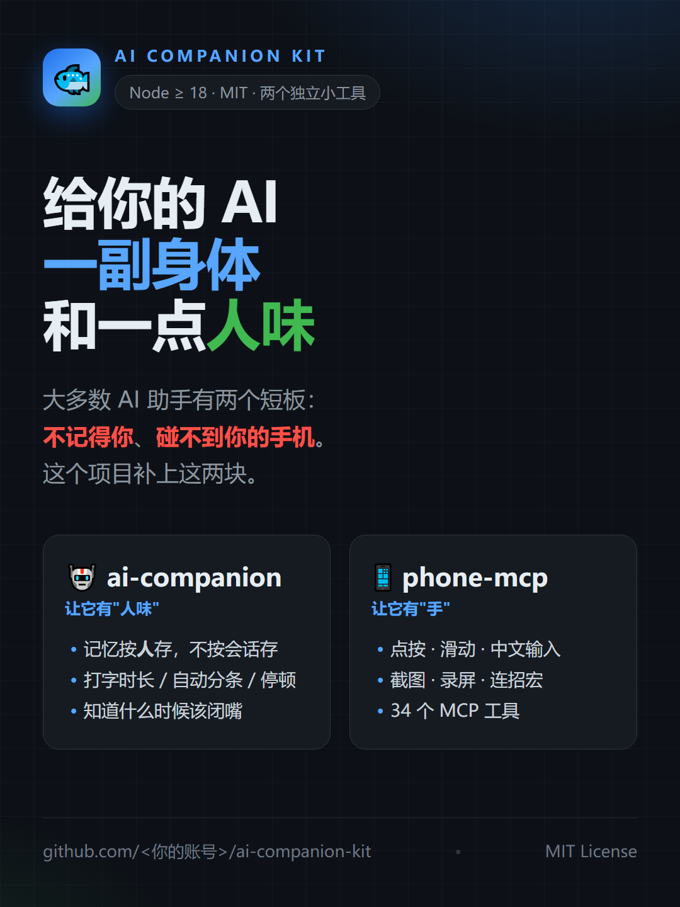
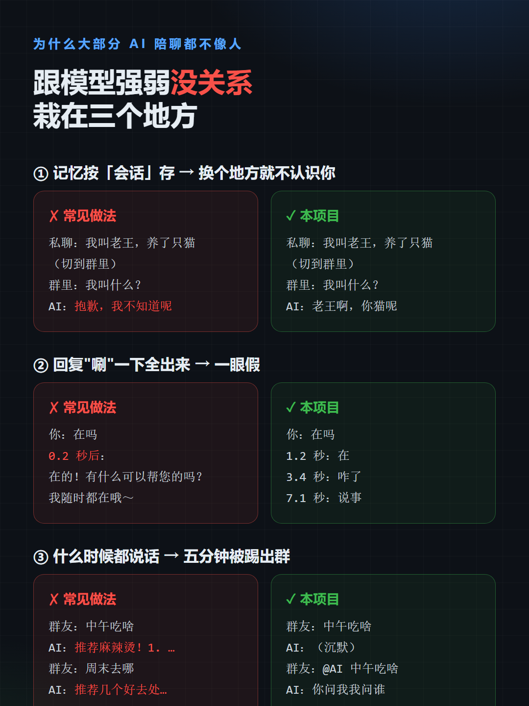
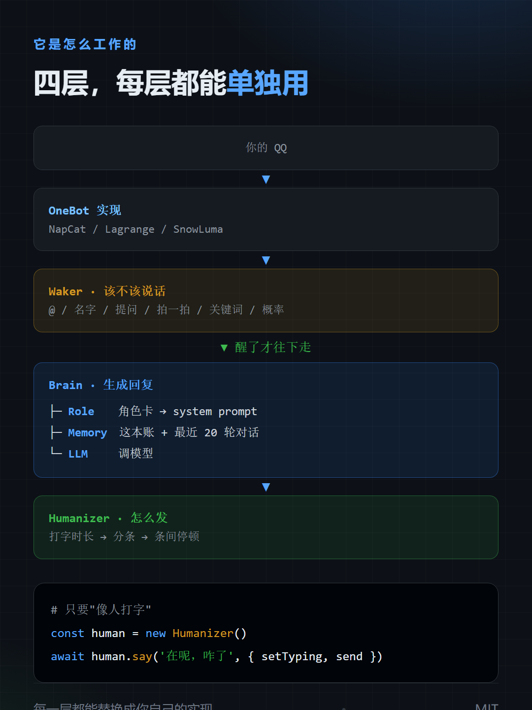
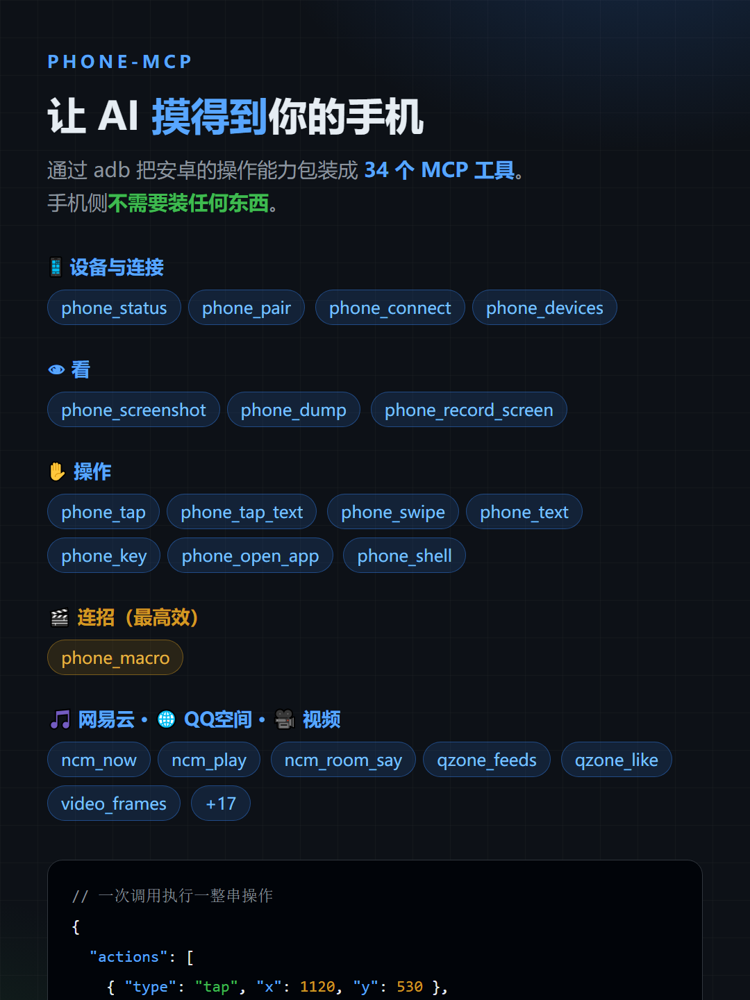
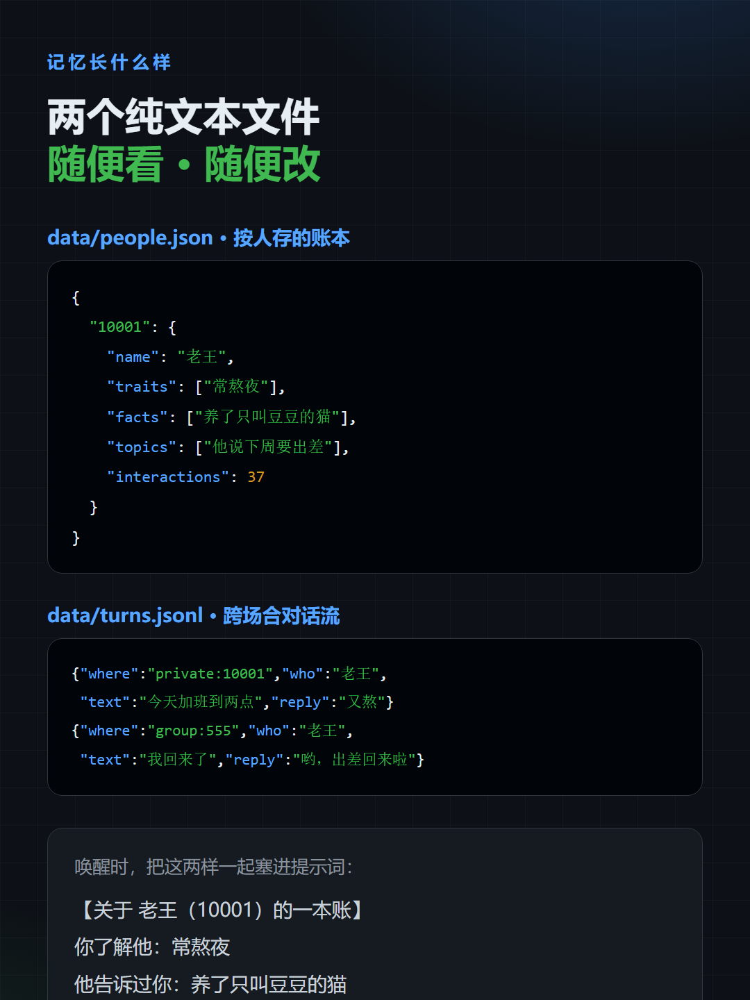
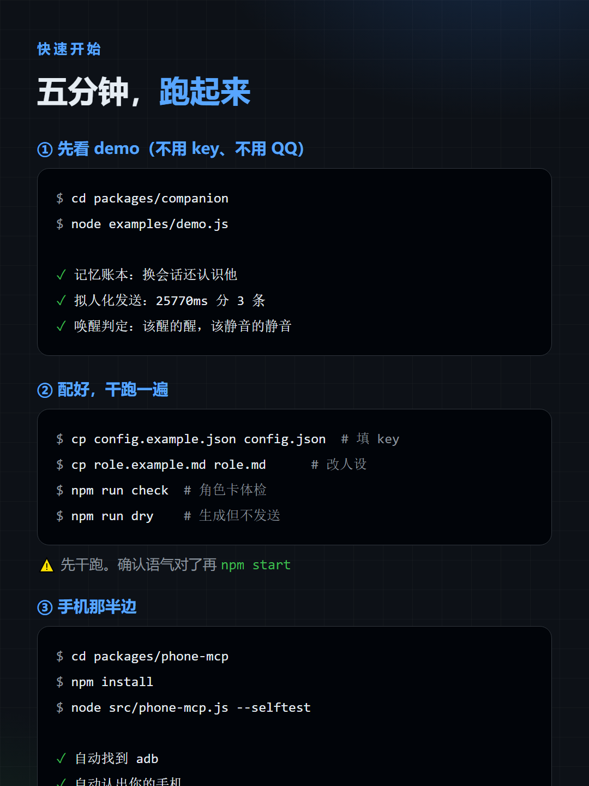

<div align="center">

# AI Companion Kit

**给你的 AI 一副身体，和一点人味。**

[](LICENSE)
[](https://nodejs.org/)

两个独立的小工具，可以分开用，也可以拼在一起：

<table>
<tr>
<td align="center" width="50%">

### 🤖 [ai-companion](./packages/companion)

让它**记得住你**、**打字像人**、**知道什么时候该闭嘴**

角色卡 · 记忆账本 · 拟人化发送 · 唤醒策略

</td>
<td align="center" width="50%">

### 📱 [phone-mcp](./packages/phone-mcp)

让它**摸得到你的手机**

点按 · 滑动 · 中文输入 · 截图 · 录屏 · 连招 · 网易云 · QQ空间

</td>
</tr>
</table>

</div>

---

## 📖 完整教程（从零搭一只小鲸鱼）

想直接搭一套**住进 QQ 里的 AI 陪伴体**？看这两份：

| | | |
|---|---|---|
| ⚡ **[快速开始 · 15 分钟跑起来](docs/快速开始-15分钟跑起来.md)** | 4.7k 字 | 最短路径，先跑起来看到效果 |
| 📚 **[完整教程 · 从零搭一只小鲸鱼](docs/完整教程-从零搭一只小鲸鱼.md)** | 18.5k 字 | 语音/手机/听歌/日记/防风控，含 15 个真实踩坑记录 |

教程里覆盖的能力：

```
聊天 · 群聊 · 记忆 · 表情包 · 发图 · 截图
语音识别（本地 whisper） · 知道你听什么歌
看手机屏幕（adb + 模拟器） · 自己写日记
主动找你 · 开关机脚本 · ★防风控★
```

> ⚠️ 教程第十三章是**保命章节**。我用 20 条/分钟的发送频率作了一整天，
> 被腾讯限速了 —— 服务端直接不回包。**别跳这一章。**

---

## 这两个东西解决什么问题

市面上的 AI 助手已经很强了，但它们有两个共同的短板：

**① 没有人味。** 回复"唰"一下全出来、一次说一大段、
不管你在群里闲聊还是在跟它说正事，它都用同一种客服腔。
而且它**不记得你**——今天说完，明天就忘。

**② 没有手。** 它能写代码、能查资料、能分析数据，
但它**碰不到你的手机**——开不了 App、点不了按钮、看不了屏幕。

这个仓库补上这两块：

| 缺什么 | 谁补 | 怎么补 |
|---|---|---|
| 记不住人 | `ai-companion/Memory` | 记忆按**人**存，不按会话存；跨场合共享一条对话流 |
| 不像人打字 | `ai-companion/Humanizer` | 打字时长、自动分条、条间停顿、深夜变慢 |
| 太吵 | `ai-companion/Waker` | @/名字/提问/拍一拍/关键词/概率，条件独立，可潜水 |
| 不像"她" | `ai-companion/Role` | 角色卡 + 体检，防止写成客服手册 |
| 碰不到手机 | `phone-mcp` | 34 个 MCP 工具，通过 adb 驱动真机或模拟器 |

---

## 长什么样

<div align="center">

| 主视觉 | 三个问题 |
|---|---|
|  |  |

| 架构 | 手机功能 |
|---|---|
|  |  |

| 记忆长什么样 | 快速开始 |
|---|---|
|  |  |

<sub>这几张图在 <code>assets/screenshots/</code>，可以直接拿去发社交媒体。</sub>

</div>

---

## 30 秒看效果


**记忆按人存 —— 换了地方还认识你**

```
【关于 老王（10001）的一本账】
你了解他：常熬夜
他告诉过你：养了只叫豆豆的猫
你们聊过：他说下周要出差
（这条是他在群里说的，但你私聊时也记得）
```

**打字像人 —— 不是"唰"一下**

```
+     0ms  正在输入…
+  2357ms  发出：刚看到消息。你那事我想了一下，感觉不用太急
+ 12072ms  正在输入…
+ 13463ms  发出：明天先问问再说吧
+ 24490ms  正在输入…
+ 25770ms  发出：我先去吃饭了
```

**知道该不该说话**

```
🔔 醒     @ 了她                  （因为 atMention）
🔇 静音   叫了名字（群里=不醒）
🔔 醒     主人说话                （因为 owner）
🔇 静音   别人闲聊
🔔 醒     别人拍了她              （因为 poke）
🔔 醒     私聊（默认全理）         （因为 anyMessage）
```

**能用手了**

```jsonc
// 一次调用执行一整串手机操作
{
  "actions": [
    { "type": "tap",   "x": 1120, "y": 530 },
    { "type": "swipe", "x1": 640, "y1": 600, "x2": 640, "y2": 200 },
    { "type": "text",  "text": "你好呀" }
  ],
  "repeat": 10,
  "saveAs": "daily_run"
}
```

---

## 快速开始

### 只要陪伴

```bash
cd packages/companion
cp config.example.json config.json     # 填 API key 和你的 QQ 号
cp role.example.md role.md             # 改成你想要的角色

npm run check     # 角色卡体检
node examples/demo.js    # 离线 demo，不需要 key
npm run dry       # 干跑：生成但不发送
npm start         # 真跑（需要一个 OneBot 实现，见包内 README）
```

### 只要手机

```bash
cd packages/phone-mcp
npm install
node src/phone-mcp.js --selftest     # 自动探测 adb 和设备
```

然后在你常用的 MCP 客户端里配上它：

```json
{
  "mcpServers": {
    "phone": { "command": "npx", "args": ["-y", "phone-mcp"] }
  }
}
```

---

## 两个包怎么配合

它们**不互相依赖**，但拼在一起会很有意思：

```
        ┌──────────────────────────────────────────┐
        │  一个"住在你设备里"的 AI                   │
        └──────────────────────────────────────────┘
                            │
        ┌───────────────────┴───────────────────┐
        │                                       │
   ┌────▼─────────────────┐         ┌───────────▼────────────┐
   │  ai-companion        │         │  phone-mcp             │
   │                      │         │                        │
   │  记得住你             │         │  能开 App、点按钮       │
   │  打字像人             │◀───────▶│  能截图、能录屏         │
   │  知道该不该说话        │  一起用  │  能玩游戏、能刷视频      │
   └──────────────────────┘         └────────────────────────┘
```

例如：让它替你在手机上签到、刷视频、玩游戏，
同时它在 QQ 上还是那个记得你昨天熬夜、会催你早睡的熟人。

也可以只用一半：
- 只想给自己做个"会记住我的 QQ 机器人" → 只用 `companion`
- 只想让 AI 帮着点手机 → 只用 `phone-mcp`

---

## 目录结构

```
ai-companion-kit/
├── packages/
│   ├── companion/                 # 陪伴：记忆 / 角色 / 拟人化 / 唤醒
│   │   ├── src/
│   │   │   ├── memory.js          记忆账本（按人存 + 跨场合对话流）
│   │   │   ├── role.js            角色卡 → system prompt + 体检
│   │   │   ├── brain.js           拼上下文 → 调模型 → 写回记忆
│   │   │   ├── humanize.js        打字时长 / 分条 / 停顿
│   │   │   ├── wake.js            该不该说话 / 潜水
│   │   │   ├── transport-onebot.js  QQ（OneBot v11）适配
│   │   │   ├── index.js           命令行入口
│   │   │   └── lib.js             库入口
│   │   ├── examples/demo.js       离线 demo（不需要 key）
│   │   ├── role.example.md        角色卡模板
│   │   └── config.example.json    配置模板
│   │
│   └── phone-mcp/                 # 手机：34 个 MCP 工具
│       └── src/
│           ├── phone-mcp.js       MCP 服务器（adb 封装 + 工具定义）
│           └── ncm.js             网易云音乐客户端
│
├── docs/                          更多文档
├── assets/screenshots/            演示图
└── LICENSE
```

---

## 设计原则

写这两个包的时候守了几条：

**1. 每一层都能单独用。**
不搞"必须整套上"的框架。只想要拟人化发送？`new Humanizer()` 就完事。

**2. 不绑定平台和模型。**
`companion` 只依赖 OpenAI 格式的接口；换平台只写一个 transport。
`phone-mcp` 只依赖 adb；换手机不用改代码。

**3. 数据都是纯文本。**
账本是 JSON，对话流是 JSONL。随时能打开看、能 grep、能手改、能备份。

**4. 不确定的事明确报错，不静默失败。**
没装 ADBKeyboard 就说"没装"，而不是默默把中文丢掉。

**5. 该闭嘴的时候闭嘴。**
一个不会看场合的机器人，比不会说话的更烦人。

---

## 注意

⚠️ **`phone-mcp` 给 AI 的是真手机的完整操作权。**
不要接到装着支付、银行 App 的主力机上；推荐用模拟器或备用机。
QQ 空间评论这类"发出去撤不回"的操作，项目里已内置限流，请保留。

⚠️ **`companion` 会把你和它的对话存在本地。**
数据不出本机（除了发给模型的那部分）。介意的话看一下 `data/` 目录。

---

## License

[MIT](LICENSE) —— 随便用，改，商用都行。
